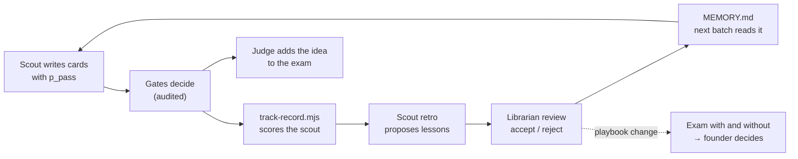

# The brain — how the team remembers and learns

Agents in this skill start every run with an empty context. Whatever they
"know" between runs has to be in files. The brain is that set of files: a
folder of plain markdown in the project (`brain/`, copied from
`templates/brain/`), versioned in git, readable in Obsidian or any editor,
and the same on every runtime — Claude Code, headless runs, Rakazo bots.

## Genome and experience

Two kinds of knowledge, kept apart on purpose:

| | Genome — in the skill | Experience — in the project's `brain/` |
|---|---|---|
| What | how a role works | what it learned here |
| Files | `agents/<role>/ROLE.md`, `playbook.md`, `evals/`; `library/` | `brain/agents/<role>/MEMORY.md`, `lessons/`, `track-record.md`, `playbook-local.md`; `world/`, `ideas/`, `library/` |
| Changes | by pull request to the skill | by the librarian, with the founder's approval for playbook changes |
| Shared | across every project that installs the skill | this project only |

A lesson that holds in several projects is proposed back to the skill's
playbook as a pull request. A role never edits its own genome.

## Five rules

1. **Memory is typed.** Knowledge (`library/`) changes rarely. Facts
   (`world/`) carry a source, a check date and an expiry date. Lessons
   (`agents/<role>/lessons/`) carry evidence links to decided ideas. Scores
   (`track-record.md`) are generated by a script and never edited by hand.
   Each type has its own way of going wrong, so each has its own check.
2. **Writes go through review.** A role proposes a lesson; the librarian,
   a different agent, accepts it only when the linked cases show what it
   claims and a search finds no counter-case. One bad session cannot teach
   the team a wrong rule.
3. **The brain forgets on purpose.** A weekly garden pass
   (`scripts/brain-lint.mjs` + the librarian) re-verifies expired facts,
   demotes lessons nobody cites, retires lessons the evidence stopped
   supporting, and keeps each `MEMORY.md` under 900 words. A role loads its
   small core every run and searches the rest only when needed, so a large
   brain does not mean a large context.
4. **Memory is private where independence matters.** Every role reads the
   shared folders. The auditor never reads the memory of the role it audits,
   so its check is not shaped by the author's habits.
5. **Learning is measured.** The scout predicts, the gates decide, and
   `scripts/track-record.mjs` scores the difference (Brier score, gate
   accuracy, calibration by source). A playbook change is accepted only when
   the role's exam does not get worse with it.

## The learning loop



After every decided batch the orchestrator runs: judge (verdicts and exam
cases) → `track-record.mjs` → scout in `retro` mode → librarian in
`review` mode. Other roles run a retro when the auditor sent their work back
twice in the same way, or when the founder asks.

A playbook amendment (a change to *how* a role works, not a single habit)
is tested before it is adopted: the orchestrator runs the role's exam on the
skill's seed cases and the project's own cases, once with and once without
`playbook-local.md`, and the founder decides with both scores in
`brain/log.md`. With fewer than ten project cases the exam is noisy; say so
next to the scores.

## What the founder does

- Drops anything into `brain/inbox/` — a thought, a link, a book to learn
  from, a voice-note transcript. video-advisor drops its briefs there too.
- Reads `brain/log.md` once a week: what the team learned, what it asks.
- Approves or rejects playbook amendments when asked.
- Keeps `FOUNDER.md` true.

Everything else — sorting the inbox, writing library notes, checking and
expiring facts, accepting lessons — is the librarian's job.

## Setup

From the project root, with the skill in `.claude/skills/idea-gates`:

```sh
cp -r .claude/skills/idea-gates/templates/brain brain
# optional: move the founder profile into the brain
git mv docs/FOUNDER.md brain/founder/FOUNDER.md
```

**Obsidian.** Open `brain/` as a vault. Links are `[[path/to/note]]` from
the vault root, which Obsidian resolves as written. To read and add to the
brain from a phone, sync the vault through git (the community *Obsidian
Git* plugin) — the same repository the agents commit to, so there is one
history.

**Schedule the upkeep.** Weekly, headless:

```sh
claude -p "Run the idea-gates librarian: garden, then review, then inbox. \
Skill directory: .claude/skills/idea-gates." \
  --permission-mode acceptEdits --allowedTools "Bash(node:*)" "Bash(git log:*)" "WebSearch" "WebFetch"
```

On Rakazo, the same prompt is a weekly routine on the librarian bot, and a
*when something changes* routine on `brain/inbox/` runs `inbox` mode as
soon as something is dropped in.

## A project that already has a memory

Many projects already keep research, a founder profile and lessons
somewhere. Do not copy `templates/brain/` next to them: a second memory
drifts from the first. Put a `.idea-gates.json` in the project root instead
(shape: `templates/idea-gates.example.json`) and the team uses the
project's own places:

- **`paths`** maps the logical paths the role files use (`brain/ideas`,
  `brain/agents`, `brain/inbox`, …) to the project's folders; the longest
  matching key wins, so `brain/ideas/INDEX.md` can live elsewhere than the
  idea folders. Every agent resolves a `brain/...` path through this map
  before reading or writing.
- **`idea_folder`** names a new idea's folder (e.g. `YYYY-MM-<slug>` for a
  workshop that dates its studies). Cards, gates and audits go inside it.
- **`report`** makes the judge also write the verdict in the project's own
  report format (`file`, `template`, `language`), so the project's other
  tools and people keep reading the file they always read.
- **`lessons_ledger`** is the project's cross-project lesson log. When the
  librarian accepts a lesson that would help outside idea-gates, it adds one
  line there in that file's own format, pointing to the lesson file.
- **`skill`** is where the skill is installed; **`skill_repo`** is cloned
  (`git clone --depth 1 <skill_repo> /tmp/idea-gates`) when it is not, so a
  project can use the team without vendoring a copy.

[[links]] are then written relative to the project root, which is also the
Obsidian vault. `scripts/brain-lint.mjs --config .idea-gates.json` checks
the mapped folders only, and `scripts/ideas-index.mjs` builds the idea index
from the project's existing reports as well as from new verdicts.

## When to add search beyond grep

Not before the brain has a few thousand notes. Until then, `INDEX.md`'s
Topics section plus Grep finds what an agent needs, and every retrieval is
explainable. When it stops being enough, add a local search index over
`brain/` exposed to the agents as a tool, and keep the files as the source
of truth.
